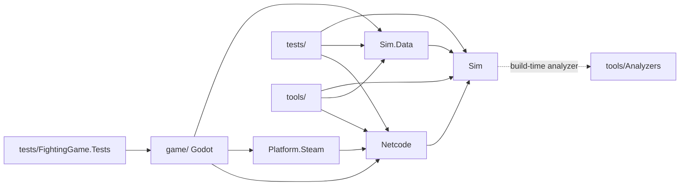
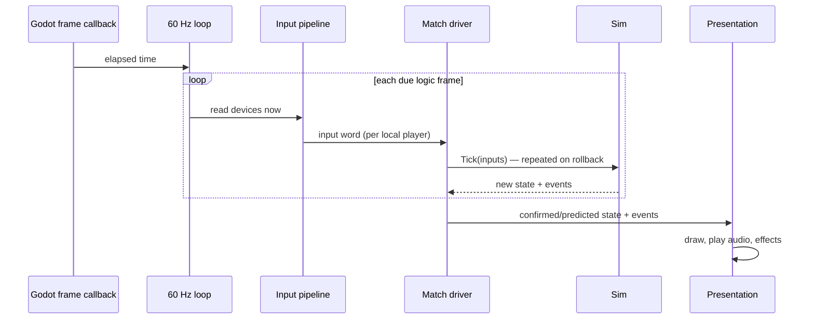

# Architecture

> **Read this before working on the code.** It holds the top-level rules every contributor (human or AI agent) must
> follow. The reasons behind them are in the [ADRs](docs/adr); implementation details are in the per-phase docs.
> If a task would break a rule here, stop and raise it instead of working around it.

## 1. The big picture

A 1v1 2D fighting game with rollback netcode, built in Godot .NET. The core idea: **game logic is a deterministic,
engine-free C# library**. Godot reads controllers, draws, and plays sound around it. The same logic runs local
matches, online matches, replays, training mode and tests.

## 2. Repo layout

```
FightingGame.sln
src/Sim/             game logic (deterministic, engine-free)
src/Sim.Data/        loads + validates character JSON, converts it to compact data for Sim
src/Netcode/         match drivers (local, online, replay, training, test) + Backdash
src/Platform.Steam/  Steamworks.NET: online transport, lobbies, Steam features
game/                Godot project: devices, drawing, audio, UI; editor plugin in game/addons/
data/                character, move and rules JSON
tests/               logic tests, plain-text scenarios, golden replays, engine-free game/ tests
tools/               desync diff, speed benchmark, replay inspector
docs/adr/            decision records
```



**Rules**
- Runtime dependencies only point the way the solid arrows show. `Sim` depends on nothing in this repo at runtime.
- The dashed arrow is a build-time analyzer reference, not a runtime dependency; architecture tests check
  compiled references only (ADR-0009).
- `Sim` and `Netcode` never reference Godot. Only `game/` and its tests may use Godot types.
- Only `tests/FightingGame.Tests` may reference `game/`, and it tests only code that runs without the engine
  (ADR-0016).
- Steam is only accessed through `Platform.Steam`, so the game still runs without Steam (dev, tests).

## 3. One frame



**Rules**
- The logic runs at a fixed **60 Hz** in our own loop, never in Godot's physics tick.
- Devices are read **immediately before** each logic frame. Input latency is a top priority: don't add buffering,
  frame queues or extra frames of delay without an ADR.
- Rollback may run the logic up to 8 frames (configurable) inside one displayed frame.

## 4. Game logic (`Sim`) rules

**Determinism: both PCs must compute bit-identical results.**
- Integers only. Positions in subpixels (1 px = 1000 units). No `float`, `double` or `decimal`.
- Banned: `System.Random`, clocks (`DateTime`, `Stopwatch`), iterating `Dictionary`/`HashSet`, LINQ, `async`,
  threads, mutable static state, I/O. Randomness uses the seeded PRNG stored in the game state.
- These are build errors (BannedApiAnalyzers); never suppress them.

**Game state**
- All match state lives in plain, fixed-size data with no object references, so saving a snapshot is a copy and
  the checksum is a hash of its bytes.
- Character/move data is read-only during a match and is **not** part of the game state.
- P1 and P2 are processed symmetrically. No rule may favour a player because of their port.

**Speed**
- One logic frame ≤ **1 ms on Steam Deck** and **no memory allocation** per frame. The benchmark runs in CI.
- This is the only performance budget in the project.

**Fixed tick order** (details in the Phase 1 doc):
input (incl. the fixed SOCD rule) → move state machines → movement → pushboxes/walls/camera → hit detection → hit resolution → mechanics modules → round/timer.

**Mechanics plug in only through the module contract** ([ADR-0011](docs/adr/0011-module-contract.md)): hooks, own
state slice, core requests. The core provides per-fighter time scale, global freeze, cancel from any state, hitstop
override and entity spawning. Gameplay settings are read only from the `MatchRules` struct.

## 5. Code design

**Goal: changing, replacing or removing any feature or mechanic must not cause a cascade of changes elsewhere.**
These rules apply to all code, and agents must follow them even when one big class would be faster to write.

**Single responsibility (most important)**
- One class has one job and one reason to change. If you need "and" to describe it, split it.
- No catch-all classes: no `*Manager`, `*Helper`, `*Utils`, `GameController` or similar.
- Size guideline: classes ~200 lines, methods ~30 lines. Longer is fine when it genuinely makes sense for that
  class (e.g. one cohesive state machine); the PR says why.
- One public type per file; the file name matches the type name.

**Features are pluggable modules**
- Every mechanic (gatlings, burst, Roman Cancel, pushback guard, …) is a self-contained module in its own folder.
  It implements a module interface and is registered in one place.
- Exception: throws (with tech) and counter hits are core fundamentals, always present
  ([ADR-0017](docs/adr/0017-core-throws-counter-hits.md)).
- The core never references a specific module. Modules never reference each other; if they must interact, they go
  through an interface or event defined by the core.
- Each module owns its own slice of game state and its own config (a developer setting).
- Character-unique mechanics that data can't express are also modules, switched on from the character's data,
  never special cases in the core.
- **Removal test:** deleting a module's folder and its registration line must still compile and pass the core tests.

**Interchangeable at the boundaries**
- Swap points are defined by small interfaces: match driver, network transport, input device, data source, loop
  host, presentation event sink, platform services (Steam).
- Don't add an interface to everything; only boundaries and things with (planned) multiple implementations.
  Keep interfaces small and focused.
- Dependencies are passed in through constructors. No singletons, service locators or static access to services.
  Godot autoloads are only used as thin startup code in `game/`.
- Add behaviour by adding a module or implementation, not with `if (feature == X)` branches or switches in the core.
- An implementation fulfils its interface completely. No `NotImplementedException` stubs.

**Human-readable**
- Use fighting-game names (`Hitstun`, `Pushback`, `CancelWindow`). No abbreviations except those in the glossary.
- Comments explain *why*, not *what*. Each public interface gets a one-line summary.
- No magic numbers: tunable values live in data as developer settings.

**Naming** (enforced by `.editorconfig`; build warnings are errors)

| What | Style | Example |
|---|---|---|
| Classes, structs, records, enums | PascalCase | `HitResolver` |
| Interfaces | `I` + PascalCase | `IMatchDriver` |
| Methods / functions | PascalCase | `ResolveHits()` |
| Public fields and properties | PascalCase | `public int Hitstun` |
| Private fields | `_camelCase` | `_inputHistory` |
| Constants | PascalCase | `MaxRollbackFrames` |
| Locals and parameters | camelCase | `frameIndex` |

**Speed beats SOLID when they conflict**
- Game state stays plain, flat data so it can be snapshotted. SOLID applies to the *behaviour*: small systems and
  modules that operate on that state.
- Interfaces and virtual calls are fine in the logic; allocations are not. Modules are created once at match start.
- **If a SOLID-style design would measurably slow down rollback or add input latency, the faster design wins.** Keep
  the exception as small and contained as possible and mark it with a `// Perf:` comment explaining why.

**Enforcement**
- Architecture tests ([ADR-0009](docs/adr/0009-architecture-tests.md)) run with the normal tests and check
  dependency directions, that `Sim` has no Godot references, that the core doesn't reference modules, and that
  modules don't reference each other.

## 6. Settings: developer vs player

**Every setting belongs to exactly one audience. Name it when you add or discuss one.**

| | Developer settings | Player settings |
|---|---|---|
| For | The two devs, to tune and experiment | People who play the game |
| Where | Dev config file + debug/control panel | Options menu |
| In shipped builds | Hidden; values baked into release data | Visible |
| Stored | `data/` (versioned in git) | `user://` settings JSON, Steam Cloud |
| Examples | Mechanic module toggles and variants, visual-effect toggles, input buffer and motion windows, rollback window, network simulator, frame data | Keybinds, vsync, input-delay override, audio volume, language, accessibility options |

**Rules**
- **Feature and mechanic toggles are developer settings by default.** A toggle only becomes a player setting by an
  explicit decision.
- **Game rules are locked for players.** Developer settings that affect gameplay form the **match rules**
  (`MatchRules`, ADR-0011): fixed in shipped builds, tweakable only during development, hashed and compared before
  online matches.
- Player settings must **never** change game logic results. Anything a player sets that affects inputs is
  applied before the input word is created (e.g. keybinds, deadzones), so it doesn't need syncing.
- Some things are neither: fixed rules such as SOCD resolution are code, not settings.

## 7. Character data

- Characters and moves are **JSON in `data/`**, one file per character and one per move, each with a schema
  version. Humans, agents and the editor all edit the same files.
- `Sim.Data` validates and converts JSON to compact integer data. Invalid data fails loudly; it is never
  silently fixed.
- All game data together produces a **data hash** used in the online version check and in replays.
- Everything about a character must be editable as data (moves, frame data, boxes, cancels, mechanics). Don't
  hard-code character-specific behaviour in the core; use a module (§5).
- Exported builds read `data/**/*.json` embedded in `Sim.Data` (ADR-0015); the editor and tests read `data/`.

## 8. Online and match drivers

- All match types (local, online, replay, training, test) go through **one match-driver interface** in `Netcode`.
  Backdash is only used behind it.
- Online traffic goes through **Steam** (Networking Messages): direct or relayed as each player's Steam setting
  allows (ADR-0014). Direct UDP is for development only.
- Before an online match, players compare game version, data hash and match rules. Mismatches never start a match.
- A desync (checksum mismatch) always produces a dump file. Never hide or auto-correct a desync.

## 9. Presentation (`game/`)

- Presentation **reads** game state and events; it **never** changes game state.
- Effects (hit sparks, sounds, shake, rumble) are triggered by **frame-tagged events** from the logic. Each event
  plays once; effects for events that disappear after a rollback are cancelled.
- Animation frames are chosen from the logic frame number, not from elapsed time.
- Visual effects are developer toggles. Placeholder art uses the same path as final art.
- Visual work never blocks gameplay work.

## 10. Testing

- Every PR: build, logic tests, scenario tests, SyncTest (determinism) and the speed benchmark must pass.
- New gameplay behaviour comes with a **plain-text scenario test** (e.g. "P1 does 5A point blank → P2 is hit on
  frame 5").
- Golden replay checksums only change intentionally, and the PR says why.

## 11. Working rules

- Decisions with lasting impact get an ADR in `docs/adr/` (next free number, plus one line in
  `docs/adr/README.md`), approved by both devs.
- Don't add dependencies (NuGet, Godot addons) without an ADR; check that their licence allows commercial use.
- Keep docs in the same PR as the code they describe.

## Glossary

- **Rollback:** online, the game predicts the opponent's input, and when the real input arrives late it rewinds and
  re-runs the frames in between.
- **Desync:** the two players' games disagree about the state; detected by comparing checksums.
- **Input word:** one player's buttons and direction for one frame, packed into 16 bits.
- **SOCD:** opposite directions held at once (left+right) on leverless controllers. Fixed rule: left+right = neutral, up+down = up.
- **Match rules:** the gameplay-affecting developer settings for a match (enabled mechanics, input windows…).
- **Frame data:** startup, active and recovery frames of a move.
- **Hitstun / blockstun / hitstop:** frames a character can't act after being hit / blocking / the brief freeze on impact.
