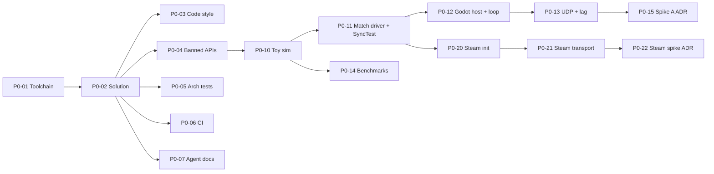

# Phase 0 — Foundation & spikes

**Goal:** a repo that enforces the architecture from the first commit, and proof that rollback (Backdash) and Steam
networking work with our setup.

**Exit (from ROADMAP):** ADR per spike; go/no-go on Backdash; versions pinned.

**Before starting:** nothing. ARCHITECTURE.md was reviewed and accepted by both devs (Oct 2026).

## A. Repo and tooling

### P0-01 Pin the toolchain
Status: done · Needs: — · Parallel: no · Where: `global.json`, `docs/adr/0001-*.md`
Read: ADR-0001
- Choose the latest stable Godot 4.x .NET release and the .NET LTS SDK it supports.
- Add `global.json` pinning the SDK; record exact Godot, .NET, C# and Backdash versions in ADR-0001.
- Confirm Godot .NET can export Windows and Linux builds with that version.

Done when:
- [x] `dotnet --version` in the repo matches `global.json`
- [x] ADR-0001 lists exact versions

### P0-02 Solution skeleton
Status: done · Needs: P0-01 · Parallel: no · Where: repo root, `src/`, `game/`, `tests/`, `tools/`
Read: ADR-0001
- Create `FightingGame.sln` with `src/Sim`, `src/Sim.Data`, `src/Netcode`, `src/Platform.Steam`, the Godot project
  in `game/`, `tests/Sim.Tests`, `tests/Architecture.Tests`, `tools/`.
- Project references exactly as in ARCHITECTURE.md §2.
- `Directory.Build.props`: nullable enabled, warnings as errors, pinned `LangVersion`, deterministic builds.
- `.gitignore` for .NET + Godot; `data/` folder with a placeholder `README.md`.
- Godot MCP addon (devs already use it) enabled in `game/` for development only: its addon folder and helper
  autoload are excluded from every export preset.

Done when:
- [x] `dotnet build` and `dotnet test` succeed on a clean clone
- [x] Godot opens `game/` and builds the C# project

### P0-03 Code style and naming
Status: done · Needs: P0-02 · Parallel: yes · Where: `.editorconfig`
Read: —
- `.editorconfig` encoding ARCHITECTURE.md §5 naming (PascalCase, `IInterface`, `_camelCase` private fields,
  camelCase locals) as errors; formatting rules.
- CI runs `dotnet format --verify-no-changes`.

Done when:
- [x] a deliberately mis-named private field fails the build

### P0-04 Banned APIs in the game logic
Status: todo · Needs: P0-02 · Parallel: yes · Where: `src/Sim/`, `src/Sim/BannedSymbols.txt`
Read: ADR-0003
- Add `Microsoft.CodeAnalysis.BannedApiAnalyzers` to `Sim` with the list from ARCHITECTURE.md §4.
- Verify `float`/`double`/`decimal` declarations are caught. If the analyzer can't, add a small custom analyzer
  in `tools/Analyzers/`.

Done when:
- [ ] using `float`, `System.Random`, `DateTime` or LINQ in `Sim` fails the build (one test file proving each)

### P0-05 Architecture tests
Status: todo · Needs: P0-02 · Parallel: yes · Where: `tests/Architecture.Tests/`
Read: ADR-0009
- Implement the checks listed in ADR-0009 with ArchUnitNET.

Done when:
- [ ] adding a Godot reference to `Sim` or a `Sim → Netcode` reference makes the tests fail

### P0-06 CI pipeline
Status: done · Needs: P0-02 · Parallel: yes · Where: `.github/workflows/`
Read: ADR-0006
- **PR (Linux):** restore, build, format check, all tests.
- **Nightly:** Windows build + Godot headless export for Windows and Linux (export templates cached).
- **Manual (`workflow_dispatch`):** soak test job, placeholder until P2-12.

Done when:
- [x] PRs show the check; nightly and manual jobs run successfully once

### P0-07 Agent and team docs
Status: done · Needs: P0-02 · Parallel: yes · Where: `CLAUDE.md` files, `CONVENTIONS.md`, `docs/adr/`, `.github/`, `.claude/`
Read: docs/phases/README.md
- Root `CLAUDE.md` already exists (imports ARCHITECTURE.md, context-finding and subagent rules). Fill in its
  **Commands** section with the real build/test/format commands; keep it short.
- Per-project `CLAUDE.md` files (`src/Sim/`, `game/`, …) only where a folder has local commands or gotchas. They
  link to ARCHITECTURE.md sections instead of repeating rules.
- `CONVENTIONS.md` proposal: folder layout inside each project, file and asset naming, commit message format.
  **Devs confirm before merge.** Add one line pointing to it in `CLAUDE.md`.
- `docs/adr/template.md`; PR template with a checklist (single responsibility, settings audience, tests, docs).
- Optional SessionStart hook running `dotnet restore` for cloud sessions (no reminder needed: CLAUDE.md is loaded).

Done when:
- [x] both devs approved CONVENTIONS.md
- [x] a fresh agent session can build and test using only what CLAUDE.md says

## B. Spike A — netcode

### P0-10 Toy simulation
Status: todo · Needs: P0-04 · Parallel: no · Where: `src/Sim/`
Read: ADR-0003
- Two squares that move left/right/jump from an input word. Integer positions (1 px = 1000 units).
- Flat, fixed-size state struct; `Tick(inputs)`; snapshot = copy; checksum = hash over state bytes.
- Zero allocations per tick.

Done when:
- [ ] tests: same inputs → same checksum; save/restore round-trip is identical

### P0-11 Match driver interface + SyncTest
Status: todo · Needs: P0-10 · Parallel: no · Where: `src/Netcode/`, `tests/`
Read: ADR-0005, ADR-0006
- First version of `IMatchDriver` (local + Backdash-backed implementations).
- Backdash SyncTest session over the toy sim: 10,000 frames with seeded random inputs in CI.

Done when:
- [ ] SyncTest runs in the PR pipeline and fails on a deliberately added non-determinism

### P0-12 Godot host and 60 Hz loop
Status: todo · Needs: P0-11 · Parallel: no · Where: `game/`
Read: ADR-0004
- Own fixed 60 Hz loop driven from Godot's frame callback (ADR-0004); devices read right before each logic frame.
- Draw the two squares from state; vsync on by default (**player setting** to turn it off).
- Input-latency counter prototype in a developer overlay (**developer setting**).

Done when:
- [ ] local two-player control on keyboard + controller at a steady 60 Hz on a 144 Hz monitor

### P0-13 Two instances over UDP with simulated lag
Status: todo · Needs: P0-12 · Parallel: no · Where: `src/Netcode/`, `game/`
Read: ADR-0003, ADR-0005
- Backdash peer session over UDP between two instances (same PC and two PCs).
- Simulated latency, jitter and loss (Backdash options if available, otherwise a lag-injecting transport wrapper).
  Values are **developer settings**.
- Rollback window 8 frames (**developer setting**).

Done when:
- [ ] playable at 100 ms / ±20 ms / 2 % loss without desync for 10 minutes

### P0-14 Speed and allocation benchmarks
Status: todo · Needs: P0-10 · Parallel: yes · Where: `tools/Benchmarks/`
Read: ADR-0003
- Measure one tick, 8-frame resimulation, snapshot save/load and checksum; report allocations.
- Add to CI with a threshold; record a manual run on a Steam Deck.

Done when:
- [ ] numbers recorded in the Spike A ADR; CI fails if a tick allocates

### P0-15 Spike A decision
Status: todo · Needs: P0-13, P0-14 · Parallel: no · Where: `docs/adr/`
Read: ADR-0003, ADR-0005
- ADR: go/no-go on Backdash with measurements, problems found, and whether to fork/vendor it.

## C. Spike C — Steam

### P0-20 Steam initialisation
Status: todo · Needs: P0-11 · Parallel: yes · Where: `src/Platform.Steam/`, `game/`
Read: ADR-0005
- Steamworks.NET with test AppID 480; native Steam libraries copied next to the game executable.
- The game must still run without Steam (dev/test).

Done when:
- [ ] game starts with Steam running (shows the user name) and without Steam (falls back cleanly)

### P0-21 Steam relay transport
Status: todo · Needs: P0-20, P0-13 · Parallel: no · Where: `src/Platform.Steam/`
Read: ADR-0005
- Implement the Backdash transport over Steam Networking Messages (relay). Unreliable channel for inputs.
- Friend invite → connect → toy-sim match.

Done when:
- [ ] two devs on different networks play the toy sim over Steam without exchanging IP addresses

### P0-22 Steam spike decision
Status: todo · Needs: P0-21 · Parallel: no · Where: `docs/adr/`
Read: ADR-0005
- ADR: relay latency measured, issues, go/no-go.

## Phase exit checklist
- [ ] Spike A and Spike C ADRs merged with go decisions (or a plan B)
- [ ] All CI checks active; architecture and banned-API tests proven to catch violations
- [ ] Both devs played the toy sim online and agree it feels responsive
