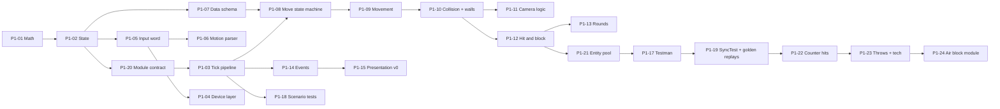

# Phase 1 — Simulation core, placeholder art, offline

**Goal:** a complete, deterministic fighting-game core with one placeholder character, playable locally on
controllers, fully driven by data.

**Exit (from ROADMAP):** both devs play local versus on controllers and it already feels responsive; CI green.

**Before starting:**
- Phase 0 exit passed.

## A. Logic foundation

### P1-01 Integer math library
Status: done · Needs: — · Parallel: yes · Where: `src/Sim/Math/`
Read: ADR-0003
- Subpixel unit (1 px = 1000), 2D integer vector, integer AABB, clamp/sign/abs helpers.
- Integer square root and lookup-table sine/cosine for the few places that need them.

Done when:
- [x] unit tests cover overflow edges and rounding direction (always documented, always the same)

### P1-02 Game state layout
Status: done · Needs: P1-01 · Parallel: no · Where: `src/Sim/State/`
Read: ADR-0003
- `MatchState` with fixed-size fighter states, input history ring buffers, round/timer, PRNG seed, and reserved
  per-module state slices (layout from P1-20).
- No references, no strings, no collections: blittable structs and fixed buffers.
- Snapshot save/restore as a copy; checksum as a hash over the bytes (own FNV-1a/xxHash implementation, no package).

Done when:
- [x] save → mutate → restore gives an identical checksum
- [x] benchmark: save + restore + checksum well under the 1 ms tick budget

### P1-20 Module contract and match rules
Status: done · Needs: P1-02 · Parallel: no · Where: `src/Sim/Modules/`, `src/Sim/Rules/`, `tests/`
Read: ADR-0011
- `IMechanicModule` hooks, per-module fixed-size state slices, core request types, module order from data.
- `MatchRules`: one blittable struct with every gameplay-affecting setting (**developer settings**); hash over the
  whole struct.
- One test-only module proving the contract.

Done when:
- [x] deleting the test module's folder and registration line still compiles and passes core tests
- [x] a test changes every `MatchRules` field in turn and the hash changes each time
- [x] architecture test: `Sim` reads gameplay settings only from `MatchRules`

### P1-03 Tick pipeline
Status: done · Needs: P1-20 · Parallel: no · Where: `src/Sim/Pipeline/`
Read: ADR-0003, ADR-0011
- One small system class per step in ARCHITECTURE.md §4's fixed order; the pipeline only runs them in order.
- Calls module hooks and applies core requests in a fixed order (ADR-0011).
- Implements the reserved core capabilities: per-fighter time scale, global freeze with exemptions, cancel from any
  state, per-fighter hitstop override. Each proven by a test with a test-only module.
- P1/P2 processed symmetrically: both read the previous frame's state, results are applied together.

Done when:
- [x] architecture tests pass; a test proves swapping P1 and P2 inputs mirrors the result

## B. Input

### P1-05 Input word and history
Status: done · Needs: P1-02 · Parallel: yes · Where: `src/Sim/Input/`
Read: ADR-0002, ADR-0010, CURRENT_STATE §3 Controls
- Button set loaded from data (`data/input/buttons.json`): A, B, C, D, Special, Dash. **Developer setting.**
- 16-bit input word: 4 direction bits + 6 button bits from the button set + 6 spare bits.
- No logic branches on a specific button name or count; everything goes through the button set.
- **SOCD fixed rule** applied here, in the logic's input step: left+right = neutral, up+down = up (ADR-0002).
  Not a setting.
- Per-player input history in game state for motion detection and buffering.

Done when:
- [x] a test with a 5-button set passes without code changes
- [x] tests: raw left+right gives neutral, raw up+down gives up
- [x] input word layout documented in code

### P1-04 Device layer
Status: done · Needs: P1-05 · Parallel: yes · Where: `game/Input/`
Read: ADR-0002, ADR-0010, CURRENT_STATE §3 Controls
- Godot keyboard + joypad reading → per-player bindings → raw input word (no SOCD cleaning here; the logic does it).
- Bindings and deadzones: **player settings** (saved properly in Phase 5; a dev file is fine for now).
  Dev file: `user://dev_bindings.jsonc`, created from `game/Input/default_bindings.jsonc` on first run.
- Steam Input and raw joypad must not produce double inputs. Rule in `JoypadRoster`: joypads on Steam Input's
  ignore list are never read; every other joypad fills exactly one player slot.
- Tests: `tests/FightingGame.Tests` (ADR-0016).

Done when:
- [x] a leverless controller holding left+right sends both bits; the logic resolves it to neutral
- [x] rebinding a button in the dev file works on keyboard and controller

### P1-06 Motion parser and buffer
Status: done · Needs: P1-05 · Parallel: yes · Where: `src/Sim/Input/Motions/`
Read: ADR-0002, ADR-0010, CURRENT_STATE §3 Controls
- Data-driven motion definitions (236, 214, 623, 41236, 63214, 22, 236236, 632146).
- Motion window 12 frames, button buffer 2 frames. **Developer settings** in `MatchRules`.
- Priority order when several motions match on the same frame, defined in data.
- Built: `data/input/motions.json` (rules in `data/README.md` → Motions), loader in `src/Sim.Data/Motions/`,
  `MotionParser` + per-character `MoveInputMatcher` in `src/Sim/Input/Motions/`.
- Follow-ups: wire `MoveInputMatcher` into `IMoveInput` (after P1-09); load motions in `GameDataLoader` (data hash,
  `ApplyTo(ref MatchRules)`, check move motions exist); plain-text scenario versions once P1-18 lands; consume a
  buffered press once it started a move.

Done when:
- [x] tests for each motion, buffer edges (frame 2 accepted, frame 3 rejected) and priority conflicts (unit tests
  in `tests/Sim.Tests/Input/Motions/`; plain-text scenario versions follow P1-18)

## C. Character data

### P1-07 Character data schema v1
Status: done · Needs: P1-02 · Parallel: yes · Where: `data/schema/`, `src/Sim.Data/`
Read: ADR-0007
- JSON schema: character file (stats, move list, state machine) and move file (frame data, per-frame boxes,
  cancel windows, hit properties, motion + button).
- `Sim.Data`: load → validate (loud, specific errors) → convert to compact integer data → data hash.
- Godot export preset includes `data/**/*.json`. Replaced by
  [ADR-0015](../adr/0015-shipping-game-data.md): `data/` is outside `res://`, so exports embed it in `Sim.Data`.
- Format and loading pattern: [data/README.md](../../data/README.md).

Done when:
- [x] invalid files give errors naming file, field and reason
- [x] same data → same hash on Windows and Linux

## D. Gameplay core

### P1-08 Move state machine
Status: done · Needs: P1-03, P1-07 · Parallel: no · Where: `src/Sim/Fighters/States/`
Read: ADR-0007, CURRENT_STATE §3 Movement/Offense/Defense
- States: idle, walk, crouch, jump (prejump/air/landing), dash, backdash, attack (startup/active/recovery),
  hitstun, blockstun, knockdown, wake-up.
- Transitions and cancel windows come from data; the state machine contains no character-specific code.

### P1-09 Movement
Status: done · Needs: P1-08 · Parallel: no · Where: `src/Sim/Fighters/Movement/`
Read: CURRENT_STATE §3 Movement
- Walk, dash (run or step per character), backdash with invulnerability, jump with prejump, high jump, gravity.
- Air actions (double jump, air dash) sharing a per-character budget. Values from data.
- Built: `MovementStage` (pipeline Movement step). Velocity order: takeoff → move `velocity` data → walk speeds
  (ground) or momentum + gravity (air). Dash/backdash/air dash speeds and backdash `invulnerable` frames are move
  data (developer settings); jump values are character stats. State machine sets `Takeoff`, spends air actions;
  movement refills them on landing. New basic states `airDash`, `airBackdash`.
- For P1-06: implement `IMoveInput` dash (66 / 44, ground and air), `IsHighJumpTriggered` (2→8 family, checked on
  the frame a prejump starts) and `IsAirJumpTriggered` (fresh up in the air). `ButtonPressMoveInput` is the
  stand-in (dash button mask passed in by the caller).
- Follow-ups: scenario tests (walk, jump arcs, high jump, run/step dash, backdash invulnerability, double jump,
  air dash, budget refill) once P1-18's runner lands; P1-12 reads `MoveData.IsInvulnerableOn` and sets
  `IsAirborne` + upward velocity for launchers.

### P1-10 Collision, walls and corners
Status: done · Needs: P1-09 · Parallel: no · Where: `src/Sim/Collision/`
Read: CURRENT_STATE §3 Match
- Box types: hit, hurt, push, throw. Per-frame boxes from move data.
- Pushbox resolution, stage walls, corners, crossups and side switching.

Done when:
- [x] scenario tests: corner push, crossup side switch, jumping over a cornered opponent

### P1-11 Camera logic
Status: done · Needs: P1-10 · Parallel: yes · Where: `src/Sim/Camera/`
Read: ADR-0004
- Horizontal camera position and max player distance in the logic (ADR-0004). Zoom/shake are presentation.
- Built: `MatchState.Camera`, `MatchRules.MaxPlayerDistance` (developer setting, `data/rules/match.json`) and
  `CameraStage`, run after the pushboxes and walls in the collision step via `Pipeline/StageSequence`. Behaviour
  is in the `CameraStage` doc comment.

Done when:
- [x] scenario tests: camera follows and stops at the walls, fighters walking apart are held at the max distance
  (`tests/Scenarios/Camera/`)

### P1-12 Hit and block
Status: done · Needs: P1-10 · Parallel: no · Where: `src/Sim/Combat/`
Read: CURRENT_STATE §3 Defense
- Hit detection, stand/crouch block, high/low/overhead, chip damage, hitstun, blockstun, hitstop (in logic),
  damage and health.
- Same-frame trade rules: configurable **developer setting** (GAP-12 stays open).
- Built: `HitDetectionStage` and `HitResolutionStage` in the pipeline's hit detection/resolution steps, sharing
  per-frame `HitContacts`; block rules in `Blocking`, reactions in `HitReactions`. One hit per move (schema v1).
  `MatchRules.TradeRule` (developer setting, `tradeRule` in `data/rules/match.json`): `trade` = both hits land,
  `clash` = neither lands and both moves are spent (`CancelOn.Clash`, `FrameEventKind.Clash`). Behaviour is in the
  stage and `Blocking` doc comments.
- Follow-ups: pushback (`HitData.Pushback` is read but not applied), launch velocity for launchers (P1-09 note),
  the move in `FighterContact`. Counter hits, throws and air block: P1-22–P1-24.

Done when:
- [x] scenario tests for each block type, trades in both modes, hitstop freezing both fighters
  (`tests/Scenarios/Combat/`)

### P1-13 Rounds and timer
Status: done · Needs: P1-12 · Parallel: yes · Where: `src/Sim/Match/`
Read: CURRENT_STATE §3 Match
- 99 s timer, best of 3, round reset, KO and time-out. Values are **developer settings**.
- Built: `RoundStage` in the pipeline's round/timer step, with `RoundJudge` (who won), `MatchScore` (wins, match
  result), `RoundStart` (reset, also the match's start state) and `RoundInputLock` (wraps the input step). State in
  `MatchState.Round` (`RoundPhase`, `RoundEnding`, `Winners`). **Developer settings** in `data/rules/match.json`:
  `roundTimerFrames` 5940, `roundsToWin` 2, `maxRounds` 5, `roundOverFrames` 120. Events: `KnockOut`, `TimeOut`,
  `RoundStart`, `MatchEnd`. Rules (details in the class doc comments):
  - KO is checked before the timer, so a KO on the timer's last frame is a KO. The timer stops only in a global
    freeze, not in hitstop.
  - Round over: the result and wins are fixed on that frame; the logic keeps running (a KO'd fighter falls and
    lands) with neutral input for `roundOverFrames`, then the next round or match over. Damage in the pause doesn't
    count.
  - KO'd fighters stay down (`KnockOut`, `HitReactions`, state machine): a hit or chip that KOs a grounded fighter
    knocks it down at once; an airborne one falls in air hitstun and is knocked down on landing. A KO'd fighter
    holds the knockdown's last frame until the next round resets it.
  - Time-out: larger share of max health wins; equal shares draw. A draw (also a double KO) gives both a win; if
    that would give both their last win, nobody gets one and an extra round is played. Undecided after `maxRounds`
    (only via extra rounds): a draw match.
  - Match over: phase stays `MatchOver`, input neutral, the logic keeps ticking.
- Follow-ups: a round intro ("Fight!") lock; a round-start module hook (ADR-0011) for per-round module state;
  untimed rounds for training (HUD then needs the rules). The rules are in the debug panel
  (`game/Debug/DataSettingList`).

Done when:
- [x] scenario tests: KO ends the round and the next starts reset, time-out with a health lead, time-out draw,
  double KO (and at match point), two round wins end the match, timer stops in a freeze (`tests/Scenarios/Match/`)

### P1-21 Entity pool (projectiles)
Status: done · Needs: P1-12 · Parallel: no · Where: `src/Sim/Entities/`, `tests/`
Read: ADR-0011
- Fixed-size entity pool in `MatchState`; pool size per player is a **developer setting** in `MatchRules`.
- Each entity: owner, position/velocity, boxes and lifetime from move data.
- Hits against fighters reuse P1-12's hit and block rules; projectile vs projectile clashes use a durability count.
- Spawned by moves (data) and by modules (core request, ADR-0011).
- Built: `MatchState.Entities` (`EntityPool`, `EntityPool.MaxPerPlayer` = 8 slots per player in the layout);
  **developer setting** `entitiesPerPlayer` (4) in `data/rules/match.json` → `MatchRules.EntitiesPerPlayer`. Moves
  get `projectiles` (spawn frame, offset, velocity, lifetime, durability, hit boxes, hit) → `ProjectileData`. Stages
  in `Sim.Entities`, each after the fighters' stage of its step (`MatchSimulation`): `EntityMovementStage` and
  `MoveSpawnStage` (movement), `EntityHitDetectionStage`, `EntityHitResolutionStage`, and `SpawnRequestStage` for
  the modules' `SpawnRequest` (first in the round and timer step). Events `ProjectileSpawn`, `ProjectileHit`,
  `ProjectileBlock`, `ProjectileClash`, `ProjectileExpire`. Rules (details in the class doc comments):
  - Pool full: each player has its own slots; a spawn takes the owner's lowest free slot, else that spawn is refused
    and nothing changes (the newest spawn loses). Order: moves in the movement step, module requests at the end of
    the frame in module slot order. No event for a refused spawn.
  - Projectiles take the owner's facing at spawn, appear on the move's spawn frame (owner advancing), don't move on
    that frame, can hit on it, and expire on the frame after their lifetime. They ignore the owner's hitstop and
    time scale, stop in a global freeze unless the owner runs, and pass walls.
  - One hit, then gone. Only the defender gets hitstop; the owner's move records nothing (no cancel on a
    projectile's hit). Blocked by holding away from the owner like any attack, even from behind. Module
    hit/block hooks run with the owner as attacker.
  - Clash: every frame two opposing projectiles overlap, both lose 1 durability; gone at 0, and a destroyed one hits
    nothing that frame. Clashes resolve before hits; counted per pair, so order-independent.
  - `TradeRule` covers projectiles: a same-frame exchange counts projectile touches; under `clash` touching
    projectiles disappear (clash event) as fighters' moves are spent.
  - Round start empties the pool. Module spawn requests apply at the end of the frame they were made in
    (`CoreRequests.Spawns`, cleared by the entity step rather than `CoreRequestApplier`).
- Follow-ups: per-move "one projectile on screen" rule, projectiles hit by attacks (projectile hurtboxes),
  projectile hitstop/hit intervals and multi-hit, pushback (with P1-12's), owner time scale for entities, a
  `FighterContact` flag so modules can tell projectile hits apart, `data/README.md` format note.

Done when:
- [x] scenario tests: projectile hits, is blocked, expires, clashes and trades with another projectile
  (`tests/Scenarios/Entities/`, also durability, trade under the clash rule, round reset, module spawn)
- [x] pool full → spawn is refused deterministically (documented behaviour; `pool_full_refuses_a_spawn.scenario`,
  `ProjectileSpawnerTests`)

### P1-14 Frame-tagged events
Status: done · Needs: P1-03 · Parallel: yes · Where: `src/Sim/Events/`
Read: ADR-0005
- Fixed-size event buffer per frame (hit, block, whiff sound, landing…), each with frame number and stable id.
  Used by presentation now and rollback reconciliation in Phase 2.
- Built: `MatchState.Events` (`FrameEvents`), so events roll back with the state. Usage, overflow and the Phase 2
  reconciliation rule are in the `FrameEvents` doc comment; kinds and their fields in `FrameEventKind`.
- Stages emit with `state.Events.Emit(state.Frame, kind, fighter, position, detail)`; new kinds are appended to
  `FrameEventKind` by the task that first emits them (P1-08/P1-09: swing, landing; P1-12: hit, block).
- Open: modules see the state read-only, so they can't emit events yet; add a `ModuleContext` path when a module
  first needs one.

Done when:
- [x] events read back per frame with stable ids; a restored snapshot re-simulates them; overflow drops
  deterministically; no allocation (tests in `tests/Sim.Tests/Events/`)

## E. Presentation and tooling

### P1-15 Presentation v0
Status: done · Needs: P1-14 · Parallel: yes · Where: `game/Presentation/`
Read: ADR-0004, ADR-0008
- Placeholder fighters (boxes or capsules), stage floor and walls, simple HUD (health, timer).
- Hitbox overlay and frame stepping: **developer settings** in a debug panel.
- Debug panel framework for all developer settings (reads/writes `data/`).
- Animation frame picked from the logic frame number.

### P1-16 Input latency counter
Status: done · Needs: P1-15 · Parallel: yes · Where: `game/Diagnostics/`
Read: ADR-0004
- Measure from device read to the frame being shown (ADR-0004). Developer overlay; recorded per milestone.
- Built: `InputLatencyCounter` (start: `MatchLoop` after the device read; end: `Main` on Godot's frame post-draw),
  avg/max over the last `LatencyWindowFrames` drawn frames (**developer setting**, `Main.cs`), shown on the F3
  developer overlay as "input to draw". Ends at "drawn": vsync wait and monitor delay come on top (doc comment).
- Recording: at each phase exit, read the overlay in a local match with vsync on and off (F2) and write both
  avg/max next to that phase's "Latency counter numbers recorded" exit item. Baseline (P0-12): ADR-0013.

Done when:
- [x] latency from device read to draw shows on the developer overlay; counter tested
  (`tests/FightingGame.Tests/Diagnostics/`); where the numbers are recorded is defined

### P1-17 Testman
Status: done · Needs: P1-21 · Parallel: yes · Where: `data/characters/testman/`
Read: ADR-0007, ADR-0010, CURRENT_STATE §3 Controls/Offense
- ~10 moves in JSON on the A/B/C/D buttons: standing and crouching normals, a low, an overhead, a projectile, a
  reversal, a super placeholder.
- Built: `data/characters/testman/` (frame data in its move files, all **developer settings**): `5a` `5b` `5c`,
  `5d` overhead, `2a`, `2b` low, `2c` low knockdown sweep, `j_c`, `236c` fireball, `623c` reversal (invulnerable
  frames 1-8), `236236d` super placeholder (invulnerable 1-11), data gatlings light → medium → heavy → special/
  super; a basic move for every `BasicState` (backdash and wake-up invulnerable). The game loads it from `data/`
  (the fixture-character placeholder source is gone); scenarios in `tests/Scenarios/Testman/`.
- Not expressible in data yet: super meter cost and super freeze (P3-13), strike-only or throw-only invulnerability,
  multi-hit moves (a move connects once).

### P1-18 Scenario test runner
Status: done · Needs: P1-03 · Parallel: yes · Where: `tests/Scenarios/`
Read: ADR-0006
- Plain-text format: setup (characters, positions), per-frame inputs, expectations ("P2 in hitstun on frame 5").
- Runner reports the first failing expectation with the actual state.
- Format and how to add an expectation kind: [tests/Scenarios/README.md](../../tests/Scenarios/README.md).

Done when:
- [x] an agent can add a scenario without touching C#

### P1-19 SyncTest and golden replays
Status: done · Needs: P1-17, P1-18 · Parallel: no · Where: `tests/`
Read: ADR-0006
- 10,000-frame SyncTest with Testman mirror and seeded random inputs in the PR pipeline.
- Golden replays: input files + expected checksums; re-recorded only intentionally.
- Built (`tests/Netcode.Tests/`): `Matches/MatchSyncTestTests` runs the real data's Testman mirror through
  `SyncTestSession` (rollback 8) for 10,000 frames; `FightingInputs` is a seeded xorshift input generator (held
  directions, presses, jumps, runs, 236/623/214/236236 motions), stable across .NET versions. Golden replays in
  `GoldenReplays/Replays/*.replay`: characters, data hash, run-length input words, checksums every 600 frames and
  at the end, played through `LocalMatchDriver`. A data hash mismatch fails first with its own message.
  Re-record: `GOLDEN_REPLAYS_RECORD=1 dotnet test --project tests/Netcode.Tests` (keeps inputs, rewrites hash and
  checksums; a file with only `seed`/`frames` gets generated inputs), and the PR says why.

Done when:
- [x] SyncTest on the Testman mirror runs in `dotnet test` (CI); two golden replays (1 and 3 minutes) pass

## F. Core fundamentals and air block (ADR-0017)

Built before Phase 2: they change `MatchState`, `MatchRules`, character data and golden replays, which Phase 2's
handshake and desync tools build on. Every task lists each rule decision (standard modern practice) in its PR and
re-records the golden replays with the reason.

### P1-22 Counter hits (core)
Status: todo · Needs: P1-19 · Parallel: no · Where: `src/Sim/Combat/`, `src/Sim/Characters/`, `src/Sim/Events/`,
`src/Sim/Rules/`, `src/Sim.Data/`, `data/`, `tests/`
Read: ADR-0017, CURRENT_STATE §3 Offense
- A hit that lands while the defender is in an attack's startup or active frames is a **counter hit**; during the
  attack's recovery a **punish counter**.
- Extra hitstun, hitstop and damage per hit from move hit data; defaults are **developer settings** in
  `data/rules/match.json` (`MatchRules`), validated by the `Sim.Data` loader.
- Frame events (counter hit, punish counter) so presentation can show it; scenario keyword if needed.
- Projectiles: decide whether they can counter hit (standard: yes, when the defender is in startup or active).

Done when:
- [ ] scenario tests: counter hit in startup and in active, punish counter in recovery, plain hit on a free
  defender, the projectile rule, both ports (`tests/Scenarios/Combat/`)

### P1-23 Throws and tech (core)
Status: todo · Needs: P1-22 · Parallel: no · Where: `src/Sim/`, `src/Sim.Data/`, `data/`, `tests/`
Read: ADR-0017, ADR-0010, ADR-0011, CURRENT_STATE §3 Controls/Defense
- Throws are moves (category `throw`): forward or back + two buttons (CURRENT_STATE §3 Controls proposal; the PR
  picks the pair, through the button set, and says why). Range: throw boxes (P1-10) against hurtboxes.
- Tech: the defender inputs a throw within the tech window (~5 f, **developer setting**); a tech separates both.
- Throw invulnerability: no throwing a fighter in hitstun or blockstun; throw-invulnerable frames after wake-up
  and after landing (**developer settings**); airborne fighters can't be ground-thrown.
- Throw vs throw on the same frame: tech (standard). Modules see connected throws through `IOnThrowHook`.
- Testman: forward throw and back throw (`data/characters/testman/`).

Done when:
- [ ] scenario tests: forward and back throw, whiff out of range, tech inside and after the window, throw vs throw,
  no throw on a stunned, airborne or just-woken fighter, both ports (`tests/Scenarios/Throws/`)

### P1-24 Air block (module)
Status: todo · Needs: P1-23 · Parallel: no · Where: `src/Sim/Modules/AirBlock/`, `tests/Scenarios/AirBlock/`,
`data/`; a core extension only if needed (below)
Read: ADR-0017, ADR-0011, ADR-0009, CURRENT_STATE §3 Defense
- A module in `src/Sim/Modules/AirBlock/` plus one registration line; passes the removal test. Off: airborne
  fighters can't block (current behaviour).
- Config (**developer setting**, its `MatchRules` module slot): which attacks can be air-blocked (e.g. not ground
  normals); a per-move `airUnblockable` flag in move data if needed.
- If the module contract can't reach blocking decisions, add the smallest core extension (an interface or hook the
  core defines; ADR-0011 updated), never a special case for the module in the core.
- Enabled in `data/rules/match.json` by default only if the module setup works that way; else the PR says how.

Done when:
- [ ] scenario tests: air block with the module on, no air block with it off, an attack kind that can't be
  air-blocked (`tests/Scenarios/AirBlock/`)
- [ ] removal test passes

## Phase exit checklist
- [ ] Local versus with Testman on controllers; both devs agree it feels responsive
- [ ] Latency counter numbers recorded
- [ ] SyncTest, scenarios, golden replays and benchmark all green; tick ≤ 1 ms on Steam Deck
