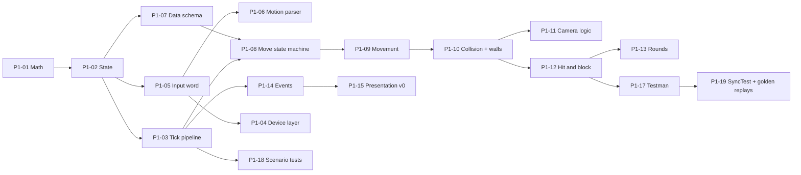

# Phase 1 — Simulation core, placeholder art, offline

**Goal:** a complete, deterministic fighting-game core with one placeholder character, playable locally on
controllers, fully driven by data.

**Exit (from ROADMAP):** both devs play local versus on controllers and it already feels responsive; CI green.

**Before starting:**
- Attack button layout decided (ROADMAP §8 Q3). Testman's moves and the input word depend on it.
- Phase 0 exit passed.

## A. Logic foundation

### P1-01 Integer math library
Status: todo · Needs: — · Parallel: yes · Where: `src/Sim/Math/`
Read: ADR-0003
- Subpixel unit (1 px = 1000), 2D integer vector, integer AABB, clamp/sign/abs helpers.
- Integer square root and lookup-table sine/cosine for the few places that need them.

Done when:
- [ ] unit tests cover overflow edges and rounding direction (always documented, always the same)

### P1-02 Game state layout
Status: todo · Needs: P1-01 · Parallel: no · Where: `src/Sim/State/`
Read: ADR-0003
- `MatchState` with fixed-size fighter states, input history ring buffers, round/timer, PRNG seed, and reserved
  per-module state slices (filled in Phase 3).
- No references, no strings, no collections: blittable structs and fixed buffers.
- Snapshot save/restore as a copy; checksum as a hash over the bytes (own FNV-1a/xxHash implementation, no package).

Done when:
- [ ] save → mutate → restore gives an identical checksum
- [ ] benchmark: save + restore + checksum well under the 1 ms tick budget

### P1-03 Tick pipeline
Status: todo · Needs: P1-02 · Parallel: no · Where: `src/Sim/Pipeline/`
Read: ADR-0003
- One small system class per step in ARCHITECTURE.md §4's fixed order; the pipeline only runs them in order.
- Module hook points defined as interfaces (empty implementations come in Phase 3).
- P1/P2 processed symmetrically: both read the previous frame's state, results are applied together.

Done when:
- [ ] architecture tests pass; a test proves swapping P1 and P2 inputs mirrors the result

## B. Input

### P1-05 Input word and history
Status: todo · Needs: P1-02 · Parallel: yes · Where: `src/Sim/Input/`
Read: ADR-0002, CURRENT_STATE §3 Controls
- 16-bit input word: 4 direction bits + buttons from the agreed layout (attack buttons, special, dash) + spare bits.
- Per-player input history in game state for motion detection and buffering.

Done when:
- [ ] layout documented in code and in the Phase 2 network docs

### P1-04 Device layer and SOCD
Status: todo · Needs: P1-05 · Parallel: yes · Where: `game/Input/`
Read: ADR-0002, CURRENT_STATE §3 Controls
- Godot keyboard + joypad reading → per-player bindings → SOCD cleaning → input word.
- SOCD mode: default left+right = neutral, up+down = up (ADR-0002). **Player setting.**
- Bindings and deadzones: **player settings** (saved properly in Phase 5; a dev file is fine for now).
- Steam Input and raw joypad must not produce double inputs.

Done when:
- [ ] scenario: holding left+right on a leverless controller produces neutral; switching the mode changes it

### P1-06 Motion parser and buffer
Status: todo · Needs: P1-05 · Parallel: yes · Where: `src/Sim/Input/Motions/`
Read: ADR-0002, CURRENT_STATE §3 Controls
- Data-driven motion definitions (236, 214, 623, 41236, 63214, 22, 236236, 632146).
- Motion window 12 frames, button buffer 2 frames. **Developer settings**, part of the match rules.
- Priority order when several motions match on the same frame, defined in data.

Done when:
- [ ] scenario tests for each motion, buffer edges (frame 2 accepted, frame 3 rejected) and priority conflicts

## C. Character data

### P1-07 Character data schema v1
Status: todo · Needs: P1-02 · Parallel: yes · Where: `data/schema/`, `src/Sim.Data/`
Read: ADR-0007
- JSON schema: character file (stats, move list, state machine) and move file (frame data, per-frame boxes,
  cancel windows, hit properties, motion + button).
- `Sim.Data`: load → validate (loud, specific errors) → convert to compact integer data → data hash.
- Godot export preset includes `data/**/*.json`.

Done when:
- [ ] invalid files give errors naming file, field and reason
- [ ] same data → same hash on Windows and Linux

## D. Gameplay core

### P1-08 Move state machine
Status: todo · Needs: P1-03, P1-07 · Parallel: no · Where: `src/Sim/Fighters/States/`
Read: ADR-0007, CURRENT_STATE §3 Movement/Offense/Defense
- States: idle, walk, crouch, jump (prejump/air/landing), dash, backdash, attack (startup/active/recovery),
  hitstun, blockstun, knockdown, wake-up.
- Transitions and cancel windows come from data; the state machine contains no character-specific code.

### P1-09 Movement
Status: todo · Needs: P1-08 · Parallel: no · Where: `src/Sim/Fighters/Movement/`
Read: CURRENT_STATE §3 Movement
- Walk, dash (run or step per character), backdash with invulnerability, jump with prejump, high jump, gravity.
- Air actions (double jump, air dash) sharing a per-character budget. Values from data.

### P1-10 Collision, walls and corners
Status: todo · Needs: P1-09 · Parallel: no · Where: `src/Sim/Collision/`
Read: CURRENT_STATE §3 Match
- Box types: hit, hurt, push, throw. Per-frame boxes from move data.
- Pushbox resolution, stage walls, corners, crossups and side switching.

Done when:
- [ ] scenario tests: corner push, crossup side switch, jumping over a cornered opponent

### P1-11 Camera logic
Status: todo · Needs: P1-10 · Parallel: yes · Where: `src/Sim/Camera/`
Read: ADR-0004
- Horizontal camera position and max player distance in the logic (ADR-0004). Zoom/shake are presentation.

### P1-12 Hit and block
Status: todo · Needs: P1-10 · Parallel: no · Where: `src/Sim/Combat/`
Read: CURRENT_STATE §3 Defense
- Hit detection, stand/crouch block, high/low/overhead, chip damage, hitstun, blockstun, hitstop (in logic),
  damage and health.
- Same-frame trade rules: configurable **developer setting** (GAP-12 stays open).

Done when:
- [ ] scenario tests for each block type, trades in both modes, hitstop freezing both fighters

### P1-13 Rounds and timer
Status: todo · Needs: P1-12 · Parallel: yes · Where: `src/Sim/Match/`
Read: CURRENT_STATE §3 Match
- 99 s timer, best of 3, round reset, KO and time-out. Values are **developer settings**.

### P1-14 Frame-tagged events
Status: todo · Needs: P1-03 · Parallel: yes · Where: `src/Sim/Events/`
Read: ADR-0005
- Fixed-size event buffer per frame (hit, block, whiff sound, landing…), each with frame number and stable id.
  Used by presentation now and rollback reconciliation in Phase 2.

## E. Presentation and tooling

### P1-15 Presentation v0
Status: todo · Needs: P1-14 · Parallel: yes · Where: `game/Presentation/`
Read: ADR-0004, ADR-0008
- Placeholder fighters (boxes or capsules), stage floor and walls, simple HUD (health, timer).
- Hitbox overlay and frame stepping: **developer settings** in a debug panel.
- Debug panel framework for all developer settings (reads/writes `data/`).
- Animation frame picked from the logic frame number.

### P1-16 Input latency counter
Status: todo · Needs: P1-15 · Parallel: yes · Where: `game/Diagnostics/`
Read: ADR-0004
- Measure from device read to the frame being shown (ADR-0004). Developer overlay; recorded per milestone.

### P1-17 Testman
Status: todo · Needs: P1-12 · Parallel: yes · Where: `data/characters/testman/`
Read: ADR-0007, CURRENT_STATE §3 Controls/Offense
- ~10 moves in JSON: light/medium/heavy normals, a low, an overhead, a projectile, a reversal, a super placeholder.

### P1-18 Scenario test runner
Status: todo · Needs: P1-03 · Parallel: yes · Where: `tests/Scenarios/`
Read: ADR-0006
- Plain-text format: setup (characters, positions), per-frame inputs, expectations ("P2 in hitstun on frame 5").
- Runner reports the first failing expectation with the actual state.

Done when:
- [ ] an agent can add a scenario without touching C#

### P1-19 SyncTest and golden replays
Status: todo · Needs: P1-17, P1-18 · Parallel: no · Where: `tests/`
Read: ADR-0006
- 10,000-frame SyncTest with Testman mirror and seeded random inputs in the PR pipeline.
- Golden replays: input files + expected checksums; re-recorded only intentionally.

## Phase exit checklist
- [ ] Local versus with Testman on controllers; both devs agree it feels responsive
- [ ] Latency counter numbers recorded
- [ ] SyncTest, scenarios, golden replays and benchmark all green; tick ≤ 1 ms on Steam Deck
