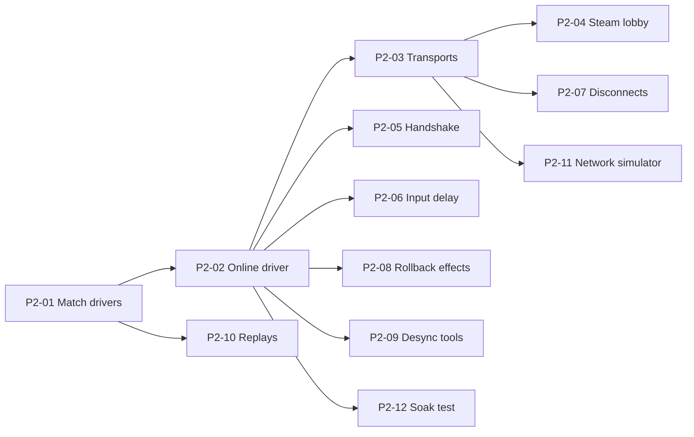

# Phase 2 — Online

**Goal:** Testman matches over Steam that feel close to local, with the tools to find and fix every desync.

**Exit (from ROADMAP):** play each other online over Steam from different networks, feels good at ~100 ms;
1-hour bot-vs-bot soak without desync.

**Before starting:** Phase 1 exit passed; Spike A/C ADRs say go.

### P2-01 Match drivers
Status: todo · Needs: — · Parallel: no · Where: `src/Netcode/Drivers/`
Read: ADR-0005
- Final `IMatchDriver`; implementations: local, SyncTest, replay, test. (Training and online follow.)
- The game in `game/` only talks to `IMatchDriver`.

Done when:
- [ ] switching driver needs no change outside the composition root

### P2-02 Online driver (Backdash)
Status: todo · Needs: P2-01 · Parallel: no · Where: `src/Netcode/Online/`
Read: ADR-0003, ADR-0005
- Backdash peer session behind `IMatchDriver`: prediction, rollback through snapshot ring buffer.
- Max rollback window 8 frames: **developer setting**.

### P2-03 Transports
Status: todo · Needs: P2-02 · Parallel: yes · Where: `src/Netcode/Transport/`, `src/Platform.Steam/`
Read: ADR-0005
- `ITransport`: direct UDP (development only) and Steam relay (from Spike C, hardened).
- Malformed or oversized packets are dropped and counted.

### P2-04 Minimal Steam lobby
Status: todo · Needs: P2-03 · Parallel: yes · Where: `src/Platform.Steam/`, `game/UI/`
Read: ADR-0005
- Create lobby, invite a friend, both ready → match. Rematch button.

### P2-05 Version handshake
Status: todo · Needs: P2-02 · Parallel: yes · Where: `src/Netcode/Handshake/`
Read: ADR-0005, ADR-0011
- Exchange game version, data hash and match-rules hash before the match.
- Mismatch → clear message ("versions differ — update the game"); match never starts.

Done when:
- [ ] the P1-20 per-field `MatchRules` hash test passes and the handshake uses that same hash
- [ ] a peer with one changed rule value (dev build) is refused

### P2-06 Input delay
Status: todo · Needs: P2-02 · Parallel: yes · Where: `src/Netcode/Online/`
Read: ADR-0005
- Automatic delay 1–2 frames from measured ping; recalculated between rounds only.
- Override 0–4: **player setting**.

### P2-07 Disconnect handling
Status: todo · Needs: P2-03 · Parallel: yes · Where: `src/Netcode/Online/`, `game/UI/`
Read: ADR-0005
- Warning after 3 s without data; match ends without a result after 10 s. Timeouts are **developer settings**.

### P2-08 Effects during rollback
Status: todo · Needs: P2-02 · Parallel: yes · Where: `game/Presentation/Events/`
Read: ADR-0005
- Play each frame-tagged event once (by id); cancel effects whose event disappears after a rollback.
- Applies to sounds, sparks, shake and rumble.

Done when:
- [ ] at 150 ms with 5 % loss, no doubled hit sounds or ghost sparks in a 10-minute session

### P2-09 Desync detection and tools
Status: todo · Needs: P2-02 · Parallel: yes · Where: `src/Netcode/Desync/`, `tools/DesyncDiff/`
Read: ADR-0005
- Per-frame checksum compared between peers.
- On mismatch, both sides write a dump (state at the last agreed frame and the first mismatched frame, inputs,
  version) to a `desyncs/` folder.
- `DesyncDiff` tool: given two dumps, lists differing fields by name.

Done when:
- [ ] a deliberately injected desync produces dumps and the tool names the exact field

### P2-10 Replays
Status: todo · Needs: P2-01 · Parallel: yes · Where: `src/Netcode/Replays/`
Read: ADR-0005
- Binary format: header (version, data hash, rules, characters, colours) + compressed inputs.
- Recorder for every match; replay driver plays it back; replays from another version are rejected cleanly.

### P2-11 Network simulator panel
Status: todo · Needs: P2-03 · Parallel: yes · Where: `src/Netcode/Transport/`, `game/Debug/`
Read: ADR-0005
- Latency, jitter and loss injection; on-screen rollback and ping stats. **Developer settings.**
- A simple ping indicator for players: **player-facing**, no settings.

### P2-12 Bot soak test
Status: todo · Needs: P2-02 · Parallel: yes · Where: `tests/Soak/`, `.github/workflows/`
Read: ADR-0006
- Two in-process peers, simulated lag/loss, seeded random inputs (CPU bot replaces these in Phase 3), 1 hour.
- Manual CI trigger only (ADR-0006).

Done when:
- [ ] one full hour without desync, run from the manual CI job

## Phase exit checklist
- [ ] Devs play over Steam from different networks; feels good at ~100 ms
- [ ] 1-hour soak passes
- [ ] Replays of online matches play back identically
