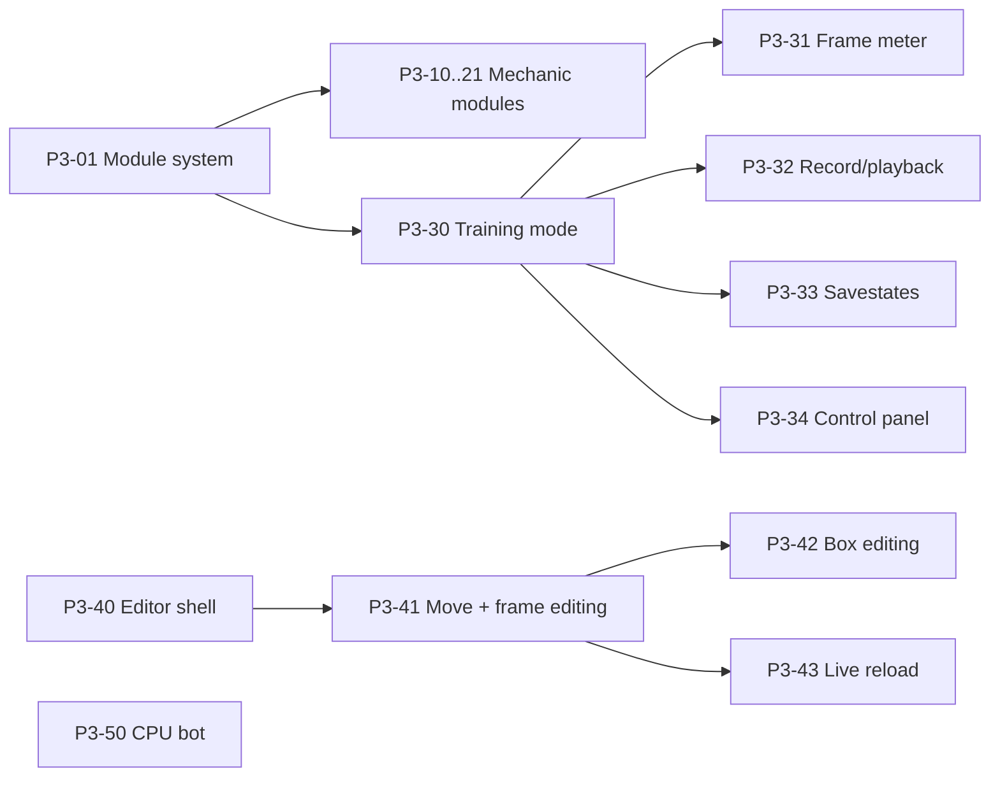

# Phase 3 — Systems & the Lab

**Goal:** the full mechanics kit as removable modules, a training mode, a character editor that needs no code, and
a simple CPU opponent.

**Exit (from ROADMAP):** Testman has the full system kit; a new move can be created in the editor without code;
variants switch between rounds in dev builds.

**Before starting:** Phase 2 exit passed. Roman Cancel v1 design (ROADMAP §8 Q4) at least sketched.

## A. Module system

### P3-01 Module toggling for development
Status: done · Needs: — · Parallel: no · Where: `src/Sim/Modules/`, `src/Sim.Data/`
Read: ADR-0005, ADR-0011
- The module contract and `MatchRules` already exist (P1-20). This task adds switching modules and their configs
  during development: changes apply by restarting the round.
- Release data contains one fixed rule set; players can never change it (ADR-0005 §8).
- Registration in one composition root. Namespace pattern `Sim.Modules.<Name>` (ADR-0009).

Done when:
- [ ] switching a module on/off in a dev build restarts the round with the new rules and a new rules hash
- [ ] a release build has no way to change match rules

## B. Mechanic modules

Done: P3-10, P3-12, P3-15 (after core pushback), P3-13, P3-16, P3-18 (v1 as in Guilty Gear, Lukas's call), P3-19 (core, ADR-0020), P3-17, P3-20 (closed as core, Lukas's call), P3-21.
**P3-20:** the dash button is just a button any game with dashes has, not a module: the core (P1-09) already does
dash, backdash and air dash from it; scenarios in `tests/Scenarios/DashButton/`. Still to check: dash with no
direction stops after 1 frame for run-style characters (core bug?).
Each module task: **Needs: P3-01 · Parallel: yes · Where: `src/Sim/Modules/<Name>/`, `tests/Scenarios/<Name>/`**.
**Read:** ADR-0011 (module contract), ADR-0005 §8 (rules locked for players), and the `CURRENT_STATE §3` subsection for the mechanic
(Offense: P3-10, P3-12 · Meter: P3-13, P3-18 · Defense: P3-15–17 · Controls: P3-19–20 · Movement: P3-21).
Each is toggleable (**developer setting**), has scenario tests, and passes the removal test.
Counter hits and throws with tech are core, not modules (ADR-0017): P1-22 and P1-23; air block is module P1-24.

| ID | Module | Key behaviour |
|---|---|---|
| P3-10 | Gatlings & cancels | Per-character chain routes, jump cancels, normal → special → super cancels (from data) |
| P3-12 | Combo limits | Damage proration, hitstun decay, gravity scaling, OTG rules |
| P3-13 | Meter & supers | Tension-style 0–100 meter, gain from attacking/moving forward, supers cost 50 % |
| P3-15 | Pushback guard | Meter-costing block with extra pushback: back + guard buttons (attacks locked meanwhile), cost per block + drain in blockstun, no chip (switchable) |
| P3-16 | Instant block | Just-in-time block reward |
| P3-17 | Burst | Combo breaker on its own gauge |
| P3-18 | Roman Cancel v1 | Guilty Gear style: buttons together spend meter, cancel into neutral (own hitstop ends), freeze + opponent slowdown; red/purple/blue/yellow switchable |
| P3-19 | Special button | GBVS-style shortcut specials with a tunable trade-off (damage or cooldown); core, not a module (ADR-0020) |
| P3-20 | Dash button | Dedicated dash input behaviour: core, no module (closed) |
| P3-21 | Negative penalty | Penalty for running away: retreat frames (own walk back, backdash, jump back) build to a meter loss + module event; forward movement wins them back |

Done when (each):
- [ ] scenario tests cover the main behaviour and the module switched off
- [ ] removal test passes

## C. Training mode

### P3-30 Training mode shell
Status: done (Godot playtest pending) · Needs: P3-01 · Parallel: no · Where: `src/Netcode/Drivers/`, `game/Training/`
Read: ADR-0007
- Training match driver; dummy options (stand, crouch, block all, block after first hit, jump, record).
  Dummy options are **player settings** in the training menu.

### P3-31 Frame meter
Status: done (Godot visual check pending) · Needs: P3-30 · Parallel: yes · Where: `src/Sim/Diagnostics/`, `game/Training/`
Read: ADR-0007
- Logic reports each fighter's frame state (startup/active/recovery/stun/invincible) every frame (ADR-0007).
- Strive/SF6-style bar with frame advantage. Shown/hidden: **player setting**.

### P3-32 Record and playback
Status: done (Godot playtest pending) · Needs: P3-30 · Parallel: yes · Where: `game/Training/`, `src/Netcode/Drivers/Training/`
Read: —
- Record dummy inputs in slots, play back once/looped/randomised.

### P3-33 Savestates
Status: done (Godot playtest pending) · Needs: P3-30 · Parallel: yes · Where: `game/Training/`
Read: ADR-0007
- Reuse rollback snapshots; kept in memory while training is open, no time limit, not saved to disk (ADR-0007).

### P3-34 Developer control panel
Status: done (Godot check pending) · Needs: P3-30 · Parallel: yes · Where: `game/Debug/`
Read: ADR-0005
- Toggle modules and edit their configs (restarts the round). **Developer settings**; not present in release builds.

## D. Character editor

### P3-40 Editor plugin shell
Status: done (Godot editor check pending) · Needs: — · Parallel: yes · Where: `game/addons/character_editor/`
Read: ADR-0007
- Godot editor plugin: open a character, list moves, save JSON via `Sim.Data` (same validation as the game).

### P3-41 Move and frame data editing
Status: done (Godot editor check pending) · Needs: P3-40 · Parallel: no · Where: `game/addons/character_editor/`
Read: ADR-0007
- Create/duplicate/delete moves; frame timeline with startup/active/recovery; cancel windows; hit properties;
  motion + button; per-module character data (e.g. meter gain).
- Forms are built from `data/schema/`, so per-module character data becomes editable once a module adds its field
  to `character.schema.json` (none does yet; meter gain is a match-rules config today).

### P3-42 Box editing
Status: done (Godot editor check pending) · Needs: P3-41 · Parallel: no · Where: `game/addons/character_editor/`
Read: ADR-0007
- Draw and resize hit/hurt/push/throw boxes per frame over the placeholder model; copy boxes between frames.
- Editing a frame of a multi-frame box splits that frame out (toggle); copies that match a neighbour join its range.
  Projectile boxes are still edited in the file.

### P3-43 Live reload into training
Status: done (Godot playtest pending) · Needs: P3-41, P3-30 · Parallel: yes · Where: `game/`, `src/Sim.Data/`
Read: ADR-0007
- Saving in the editor reloads data into a running training match (round restarts).
- Editor runs poll `data/**/*.json` (`game/Debug/DataChangeWatch`); once a save settles, a local or training match
  is rebuilt with the new data, the same path as the debug panel's saves. Savestates go, recordings stay; online
  matches keep running.

Done when (editor as a whole):
- [ ] a dev creates a new Testman move with boxes and cancels and uses it in training, without writing code

## E. CPU bot

### P3-50 CPU bot v1
Status: done (soak with bots: run the manual 1-hour job) · Needs: P3-01 · Parallel: yes · Where: `src/Netcode/Bots/`
Read: ADR-0006
- Input provider that presses buttons like a player; never reads internals it couldn't "see".
- Simple state machine (approach, attack, block, punish); difficulty = reaction delay (**player setting** in
  versus CPU; **developer setting** for soak tests).
- Replaces the random inputs in the soak test (P2-12).

## Phase exit checklist
- [x] All modules work with Testman and pass their removal tests (each module folder has a `testman_*` scenario;
  removal of the P3-15/18/21 modules checked by hand: build and tests pass, golden replays re-record for the data hash)
- [ ] A new move is made in the editor without code
- [x] Mechanic variants switch between rounds: every mechanic is a module switched on or off (and configured) in
  data, without touching the core (ADR-0011 §9–11, Lukas's reading); per-round switching is not a goal
- [ ] Soak test passes with CPU bots
