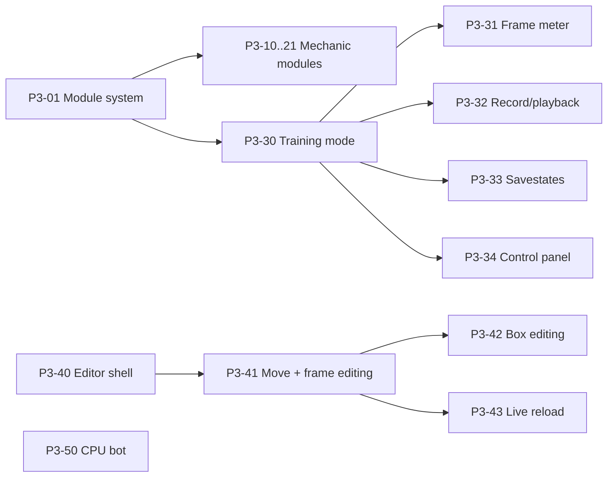

# Phase 3 — Systems & the Lab

**Goal:** the full mechanics kit as removable modules, a training mode, a character editor that needs no code, and
a simple CPU opponent.

**Exit (from ROADMAP):** Testman has the full system kit; a new move can be created in the editor without code;
variants switch between rounds.

**Before starting:** Phase 2 exit passed. Roman Cancel v1 design (ROADMAP §8 Q4) at least sketched.

## A. Module system

### P3-01 Module system
Status: todo · Needs: — · Parallel: no · Where: `src/Sim/Modules/`, `src/Sim.Data/`
Read: ADR-0005, ADR-0009
- `IMechanicModule` with hooks at the pipeline points from P1-03 (e.g. on hit, on block, on input, end of frame).
- Each module owns a fixed-size state slice in `MatchState` and its own config.
- Match rules = the set of enabled modules + their configs. **Developer settings**, hashed for the handshake,
  locked during a match; changing them in training restarts the round.
- Registration in one composition root. Namespace pattern `Sim.Modules.<Name>` (ADR-0009).

Done when:
- [ ] a sample module can be removed by deleting its folder + registration line; core tests still pass
- [ ] architecture tests enforce "core doesn't reference modules, modules don't reference each other"

## B. Mechanic modules

Each module task: **Needs: P3-01 · Parallel: yes · Where: `src/Sim/Modules/<Name>/`, `tests/Scenarios/<Name>/`**.
**Read:** ADR-0005 (match rules), the P3-01 section above, and the `CURRENT_STATE §3` subsection for the mechanic
(Offense: P3-10–12 · Meter: P3-13, P3-18 · Defense: P3-14–17 · Controls: P3-19–20 · Movement: P3-21).
Each is toggleable (**developer setting**), has scenario tests, and passes the removal test.

| ID | Module | Key behaviour |
|---|---|---|
| P3-10 | Gatlings & cancels | Per-character chain routes, jump cancels, normal → special → super cancels (from data) |
| P3-11 | Counter hits | Counter hit and punish counter (hit during recovery), extra hitstun/effects from data |
| P3-12 | Combo limits | Damage proration, hitstun decay, gravity scaling, OTG rules |
| P3-13 | Meter & supers | Tension-style 0–100 meter, gain from attacking/moving forward, supers cost 50 % |
| P3-14 | Throws & tech | Forward/back + two buttons, ~5 f tech window, throw invulnerability rules |
| P3-15 | Pushback guard | Meter-costing block with extra pushback |
| P3-16 | Instant block | Just-in-time block reward |
| P3-17 | Burst | Combo breaker on its own gauge |
| P3-18 | Roman Cancel v1 | Per the agreed design, with switchable variants |
| P3-19 | Special button | GBVS-style shortcut specials with a tunable trade-off (damage or cooldown) |
| P3-20 | Dash button | Dedicated dash input behaviour |
| P3-21 | Negative penalty | Penalty for running away |

Done when (each):
- [ ] scenario tests cover the main behaviour and the module switched off
- [ ] removal test passes

## C. Training mode

### P3-30 Training mode shell
Status: todo · Needs: P3-01 · Parallel: no · Where: `src/Netcode/Drivers/`, `game/Training/`
Read: ADR-0007
- Training match driver; dummy options (stand, crouch, block all, block after first hit, jump, record).
  Dummy options are **player settings** in the training menu.

### P3-31 Frame meter
Status: todo · Needs: P3-30 · Parallel: yes · Where: `src/Sim/Diagnostics/`, `game/Training/`
Read: ADR-0007
- Logic reports each fighter's frame state (startup/active/recovery/stun/invincible) every frame (ADR-0007).
- Strive/SF6-style bar with frame advantage. Shown/hidden: **player setting**.

### P3-32 Record and playback
Status: todo · Needs: P3-30 · Parallel: yes · Where: `game/Training/`
Read: —
- Record dummy inputs in slots, play back once/looped/randomised.

### P3-33 Savestates
Status: todo · Needs: P3-30 · Parallel: yes · Where: `game/Training/`
Read: ADR-0007
- Reuse rollback snapshots; kept in memory while training is open, no time limit, not saved to disk (ADR-0007).

### P3-34 Developer control panel
Status: todo · Needs: P3-30 · Parallel: yes · Where: `game/Debug/`
Read: ADR-0005
- Toggle modules and edit their configs live (restarts the round). **Developer settings**, hidden in release builds.

## D. Character editor

### P3-40 Editor plugin shell
Status: todo · Needs: — · Parallel: yes · Where: `game/addons/character_editor/`
Read: ADR-0007
- Godot editor plugin: open a character, list moves, save JSON via `Sim.Data` (same validation as the game).

### P3-41 Move and frame data editing
Status: todo · Needs: P3-40 · Parallel: no · Where: `game/addons/character_editor/`
Read: ADR-0007
- Create/duplicate/delete moves; frame timeline with startup/active/recovery; cancel windows; hit properties;
  motion + button; per-module character data (e.g. meter gain).

### P3-42 Box editing
Status: todo · Needs: P3-41 · Parallel: no · Where: `game/addons/character_editor/`
Read: ADR-0007
- Draw and resize hit/hurt/push/throw boxes per frame over the placeholder model; copy boxes between frames.

### P3-43 Live reload into training
Status: todo · Needs: P3-41, P3-30 · Parallel: yes · Where: `game/`, `src/Sim.Data/`
Read: ADR-0007
- Saving in the editor reloads data into a running training match (round restarts).

Done when (editor as a whole):
- [ ] a dev creates a new Testman move with boxes and cancels and uses it in training, without writing code

## E. CPU bot

### P3-50 CPU bot v1
Status: todo · Needs: P3-01 · Parallel: yes · Where: `src/Netcode/Bots/`
Read: ADR-0006
- Input provider that presses buttons like a player; never reads internals it couldn't "see".
- Simple state machine (approach, attack, block, punish); difficulty = reaction delay (**player setting** in
  versus CPU; **developer setting** for soak tests).
- Replaces the random inputs in the soak test (P2-12).

## Phase exit checklist
- [ ] All modules work with Testman and pass their removal tests
- [ ] A new move is made in the editor without code
- [ ] Mechanic variants switch between rounds
- [ ] Soak test passes with CPU bots
